<div align="center">
  
</div>

<h3 align="center">在像素之间，追查虚构的证据。</h3>
<p align="center"><sub><i>Hunting fabricated evidence, one pixel at a time.</i></sub></p>

---

我是 **Zephyr**，一个总想把论文里的模型拆开、接上 API、再塞进一个"**真的能跑起来**"的工程里的人。

- 🔍 **AI 生成图像取证** —— 判断一张图是真是假，并指出**哪里被动过**
- 🤖 **多模态 Agent 的可审计推理** —— 让取证过程留下能复查的证据链，而不是一句结论
- 🎙️ **语音与心理健康** —— 从说话的停顿、语速和内容里，读出一个人的状态

> 我不研究"怎么生成得更真"，我只研究"怎么把它认出来"。
> <sub>I don't make fakes more convincing. I make them easier to catch.</sub>

## 🗡 角色面板 · Character Sheet

| 属性 | 值 |
| :-- | :-- |
| **职业** | 图像取证学徒 · Forensics Apprentice |
| **常驻** | UTC+8 · 深夜出没 |
| **主武器** | `Python` · `PyTorch` · `FastAPI` |
| **副武器** | `C++ / Qt` · `CUDA` |
| **被动技能** | 把一堆论文模型串成一条能跑通、能演示、能交付的流水线 |
| **弱点** | 星标数还是 0 —— 路过的话，欢迎随手点一颗 ⭐ |
| **阵营** | 中立善良（怀疑一切，包括自己的检测器） |

## ⚔ 任务清单 · Quest Log

| 委托 | 一句话 | 装备 |
| :-- | :-- | :-- |
| **[FakeTrace](https://github.com/Zephyr-Feng/FakeTrace)** 「伪迹」 | 五套取证模型的统一工作台：判真假 + 像素级定位篡改区域 | `Python` `PyTorch` `FastAPI` |
| **[AIGC-Actor-Monitor](https://github.com/Zephyr-Feng/AIGC-Actor-Monitor)** 「演员与监视者」 | 让 AI 自己调用取证工具，再用一个独立 Monitor 审查它的证据链 | `Python` `LLM Agent` |
| **[Senior-Talk](https://github.com/Zephyr-Feng/Senior-Talk)** 「长者的低语」 | 一段语音 → 声学特征 + 语义证据 → 心理健康筛查报告 | `Whisper` `Qwen2.5-VL` `LoRA` |
| **[Daily-Routine-System](https://github.com/Zephyr-Feng/Daily-Routine-System)** 「日程守卫」 | 会听你说话的桌面日程管家：语音识别 + 大模型对话 | `C++` `Qt` `CUDA` |
| **[Alien-Invasion](https://github.com/Zephyr-Feng/Alien-Invasion)** 「第一次远征」 | 我的第一个 Python 项目，外星人入侵，至今没打完 | `Python` `pygame` |
| **[Files_tool](https://github.com/Zephyr-Feng/Files_tool)** 「杂役」 | 日常文件处理的顺手小刀 | `Python` |

## 🏆 值得一提 · Highlights

**把五种模型塞进同一个入口** — `MARC` 判真假，`TruFor` / `CAT-Net` / `Fassa` / `EffUnetPP` 做定位。
一个配置、一套可视化、`CLI + Web + API` 三条出口，模型层与应用层彻底分开，加新模型不用改调用方。

**让"实验"变成"证据"** — 在 Actor-Monitor 里，Actor 只能输出**可观测的**描述与工具调用，不准冒充"内心想法"；
Monitor 审查的是证据归因、充分性和冲突处理，而不是答案对不对。这套约束踩过坑：早期 Mini FaithBench 里，
`PROBE` 的观测结果曾被误写成真假倾向。

**筛查不等于诊断** — Senior-Talk 的定位是辅助筛查：二分类 73.8% 准确率，改成带引证的推理式报告后到 80.0%。
它永远不会替你下诊断，只会提醒"这段语音值得再看一眼"。

## 🧰 装备栏 · Arsenal

```text
语言    Python  ·  C++  ·  C  ·  SQL  ·  Bash
框架    PyTorch ·  FastAPI  ·  Qt  ·  CMake
模型    MARC · TruFor · CAT-Net · Fassa · EffUnetNet++ · Whisper · Qwen2.5-VL
工具    Git · Linux · Docker · CUDA · ModelScope
```

## 📜 信条 · Creed

<table>
<tr><td>🔍</td><td><b>能复现的才算结论</b><br/><sub>If it can't be reproduced, it's an anecdote.</sub></td></tr>
<tr><td>🧾</td><td><b>结论要带上证据</b><br/><sub>Every verdict ships with its receipts.</sub></td></tr>
<tr><td>🚧</td><td><b>先让它跑起来，再让它变漂亮</b><br/><sub>Make it run, then make it right.</sub></td></tr>
</table>

## 🔗 联络 · Signal

想聊图像取证、Agent 评测、语音健康筛查，或者你怀疑某张图是 AI 生成的想验证一下 —— 都欢迎。

- 💬 开个 [Issue](https://github.com/Zephyr-Feng) 或者直接在某条 commit 下面留言，我大概率会看到
- 🌬️ 别催更，风来得慢，但会到

<!-- 想公开邮箱的话，把下面这行的注释去掉即可（WordPress 式的反爬会把 @ 转成 HTML 实体）
📮 邮箱：zzf34209&#64;gmail.com
-->

<details>
<summary><b>🇬🇧 English version</b> (click to expand)</summary>

<br/>

I'm **Zephyr**, an independent developer who likes taking models out of papers, wiring them to an API,
and squeezing them into something that *actually runs*.

**Focus**

- 🔍 **AI-generated image forensics** — real/fake classification plus pixel-level tamper localization
- 🤖 **Auditable multimodal agents** — evidence trails you can review, not just a verdict you have to trust
- 🎙️ **Speech & mental health** — reading someone's state from pauses, pace, and what they actually say

**Selected work**

- **FakeTrace** — one entry point for five forensic models (`MARC`, `TruFor`, `CAT-Net`, `Fassa`, `EffUnetPP`),
  exposed as CLI, web UI, and HTTP API, with model code cleanly separated from application code.
- **AIGC-Actor-Monitor** — an Actor calls frozen forensic tools and produces auditable Evidence Cards;
  an independent Monitor reviews attribution, sufficiency, conflict handling, and whether to STOP.
  Pipeline: `Structured Actor → FaithBench → offline Monitor → online intervention`.
  Design rule: narration is observable output, never a claim about the model's inner thoughts.
- **Senior-Talk** — audio in, screening report out: VAD, Whisper transcription, acoustic features
  (rate, pauses, pitch, energy, jitter, shimmer), semantic evidence, and an MLLM review step.
  Accuracy 73.8% (binary) / 80.0% (evidence-citing reports). A screening aid, never a diagnosis.

**Creed** — if it can't be reproduced, it's an anecdote. Every verdict ships with its receipts.
Make it run, then make it right.

Open to conversations about image forensics, agent evaluation, and speech-based health screening.

</details>

<br/>

<div align="center">
  
</div>
